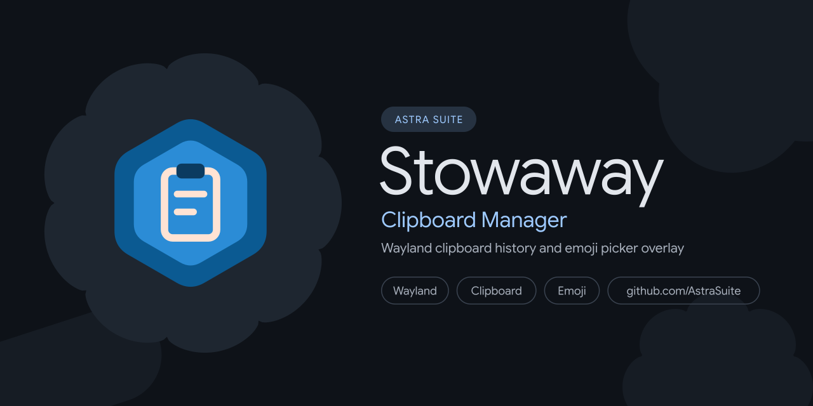

<p align="center">
  
</p>

# Shards 🧊

A Wayland clipboard manager and character picker overlay for the AstraSuite and Frost ecosystems, built with Qt 6, C++20, and QML.

[](https://github.com/SpanishSyntax/Shards/blob/main/LICENSE)
[](CMakeLists.txt)
[](CMakeLists.txt)

Shards (packaged and invoked as `stowaway`) provides a cursor-anchored Wayland layer overlay that docks silently in memory until summoned. It supports dynamic cursor tracking, multi-category clipboard history, unicode symbol filtering, and automated keystroke pasting.

---

## Why "Shards" & "Stowaway"? (The Lore)

> **ice shards** (`/ʃɑːdz/`) — *noun:* Sharp, freestanding slivers of splintered sea ice sheared from pressure ridges, compact enough to pocket, carry, and examine up close.

When sea ice fractures under thermal contraction, it leaves behind small shards—bite-sized fragments of the larger pack ice that can be collected and transported.

**Stowaway carries bite-sized clipboard fragments:**
- **Pocketed Shards**: Gathers recent clipboard history, unicode symbols, and quick-access snippets into a floating Wayland overlay that docks silently until summoned.
- **Frictionless Handoff**: Pastes text, paths, and symbols into any application with keyboard-driven speed, keeping memory overhead sub-pixel lean.

---

## Architecture Highlights

- **Dynamic Cursor-Anchored Overlay**: Uses Wayland `wlr-layer-shell-unstable-v1` and Hyprland IPC socket queries to position the popup adjacent to the active cursor with screen boundary clamping and edge flipping.
- **Sub-10ms Daemon Lifecycle**: Keeps the QML engine, plugins, and custom fonts resident in RAM with the layer surface unmapped, guaranteeing instant rendering upon trigger.
- **Categorized History**: Automatically categorizes clipboard items into Text, Code, URLs, Colors, and Images with thumbnail caching and SQLite / JSON persistence.
- **Fuzzy Character Pickers**: Unified search across standard Unicode emojis, Kaomoji text faces, and typographical symbols.
- **Automated Keystroke Dispatch**: Hands focus back to the target Wayland window before issuing paste commands via `wtype`.
- **Material 3 Expressive UI**: Fluid spring animations and Caelestia shell color token synchronization.

---

## Quick Demo

```bash
# Summon clipboard history overlay beside cursor
stowaway --toggle

# Open directly into emoji picker
stowaway --emoji

# Start resident background daemon
stowaway --daemon

# Check running daemon status
stowaway --status
```

---

## Table of Contents

- [Getting Started](getting-started.md)
  - [Installation](getting-started.md#installation)
  - [Quick Start](getting-started.md#quick-start)
  - [Daemon Configuration](getting-started.md#daemon-configuration)
  - [Systemd User Service](getting-started.md#systemd-user-service)
- [Architecture & Design](architecture.md)
  - [System Architecture](architecture.md#system-architecture)
  - [The Lore: Ice Shards & Stowaway](architecture.md#why-shards--stowaway-the-lore)
  - [Wayland Layer Shell & IPC](architecture.md#wayland-layer-shell--ipc)
  - [Sub-10ms Daemon Lifecycle](architecture.md#sub-10ms-daemon-lifecycle)
  - [Auto-Paste Mechanics](architecture.md#auto-paste-mechanics)
- [Primitives Reference](primitives.md)
  - [CLI Primitives & Triggers](primitives.md#cli-primitives--triggers)
  - [Configuration Schema](primitives.md#configuration-schema)
  - [C++ Core Controllers](primitives.md#c-core-controllers)
  - [QML Presentation Components](primitives.md#qml-presentation-components)
  - [Data Providers & Assets](primitives.md#data-providers--assets)
- [Integration & Usage Guide](usage.md)
  - [Compositor Keybindings](usage.md#compositor-keybindings)
  - [Hyprland Animation Rules](usage.md#hyprland-animation-rules)
  - [Dynamic Sizing & Scaling](usage.md#dynamic-sizing--scaling)
  - [Theme & Token Integration](usage.md#theme--token-integration)
